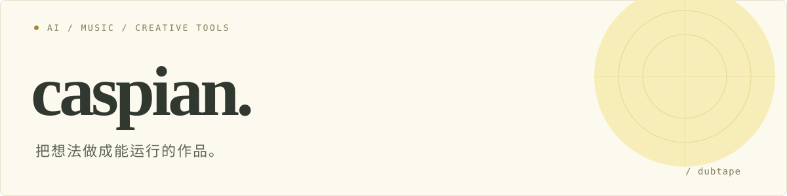

  

# Hi, I'm caspian.

我用代码把想法变成工具，也关注音乐与创作。  
这里记录一些自己会用的小项目，以及边做边学的过程。

## 我关注的方向

- **AI 应用与自动化**：把重复的操作，变成顺手的工具。
- **音乐与创作**：探索内容、信息与体验之间的连接。
- **产品实践**：从一个具体问题开始，把想法慢慢做成作品。

## 一些公开项目

<table>
  <tr>
    <td width="50%" valign="top">
      <h3><a href="https://github.com/dubtape/crypto_project">crypto_project ↗</a></h3>
      
本地运行的加密货币实时看板，探索行情监控、技术分析与数据可视化。

      
<code>Vue 3</code> <code>TypeScript</code> <code>WebSocket</code>

    </td>
    <td width="50%" valign="top">
      <h3><a href="https://github.com/dubtape/work-report">work-report ↗</a></h3>
      
网页报工表单的自动填写 Skill 模板，把重复操作整理成可复用流程。

      
<code>PowerShell</code> <code>OpenCLI</code> <code>Automation</code>

    </td>
  </tr>
</table>

也在关注和使用：

- [last30days-skill](https://github.com/dubtape/last30days-skill) — Fork 自 [mvanhorn/last30days-skill](https://github.com/mvanhorn/last30days-skill)
- [TrendRadar](https://github.com/dubtape/TrendRadar) — Fork 自 [sansan0/TrendRadar](https://github.com/sansan0/TrendRadar)

## 常用工具

`Python` · `TypeScript` · `Vue` · `Node.js` · `PowerShell`

---

边做边学，把自己遇到的问题先解决好。
